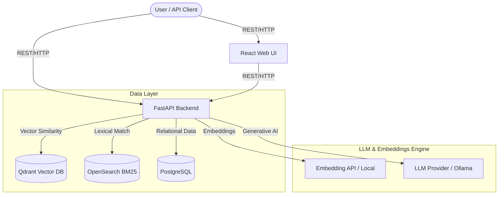
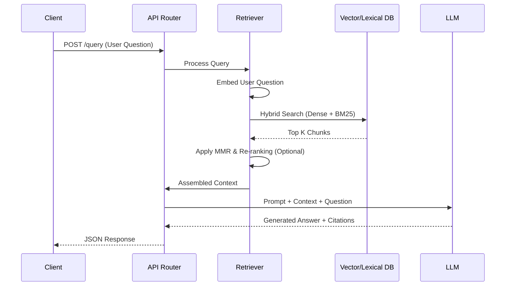

# NexusRAG


**NexusRAG** is a production-ready Retrieval-Augmented Generation (RAG) backend with a clean API and a modern web UI. It seamlessly ingests documents (TXT, MD, FB2, DOCX, PDF), builds a semantic index in Qdrant, and provides highly accurate, citation-backed answers.

You can use it as a standalone service or integrate it into other products via its flexible API.

## Core Features

- **Document Ingestion**: Fast and intelligent chunking (fixed, recursive, semantic) of unstructured documents.
- **Semantic & Hybrid Search**: Embedding-based vector search (Qdrant) and optional BM25 lexical index (OpenSearch) for precise retrieval.
- **Provider-Flexible**: Use OpenAI by default, or seamlessly switch to Anthropic, DeepSeek, Voyage, Cohere, or local models via Ollama.
- **Grounded Answers**: Responses are built from your specific documents, providing reliable source citations.
- **Retrieve-Only API**: Get relevant document chunks and context without creating chat history (ideal for automation and MCP tools).
- **Structure-Aware**: Extracts heading structures and PDF page numbers at upload for section-aware, targeted retrieval.
- **Diverse Retrieval (MMR)**: Maximal Marginal Relevance for diversity-aware search when exploring broad topics.

## Quick Start (Docker)

To launch the complete stack (API, DB, Qdrant, OpenSearch, and Frontend):

1. **Configure Environment:**
   ```bash
   cp .env.example .env
   # Add your API keys (e.g., OPENAI_API_KEY)
   ```

2. **Start the Stack:**
   ```bash
   docker compose up -d --build
   ```

3. **Access Services:**
   - **Web UI:** `http://localhost:5174`
   - **API Docs (Swagger):** `http://localhost:8004/docs`

## Minimal API Usage

NexusRAG provides a comprehensive REST API. After authenticating, you can upload documents, create knowledge bases, and query data.

**Retrieve-Only Example:**
Get context without side-effects (useful for integrations):
```bash
curl -X POST http://localhost:8004/api/v1/retrieve/ \
  -H "Content-Type: application/json" \
  -H "Authorization: Bearer <your_token>" \
  -d '{
    "query": "What is this document about?",
    "knowledge_base_id": "your-kb-id",
    "top_k": 5
  }'
```

## System Design

### High-Level Design (HLD)

NexusRAG employs a modern, decoupled service architecture designed for scalability and accurate information retrieval.



**Key Components:**
- **FastAPI Backend:** Acts as the central orchestrator, handling authentication, routing, retrieval logic, and LLM communication.
- **Qdrant (Vector DB):** Stores document chunks as dense vectors for fast, semantic similarity search.
- **OpenSearch:** Provides a BM25 lexical index, enabling hybrid search for exact keyword matching alongside semantic retrieval.
- **PostgreSQL:** Manages persistent structured data (users, document metadata, knowledge base settings, chat histories).
- **React UI:** Provides an intuitive, modern interface for admins and users to manage documents, settings, and query the system.

### Low-Level Design (LLD)

The low-level architecture focuses on the data ingestion pipeline and the Retrieval-Augmented Generation (RAG) execution flow.

#### 1. Ingestion Pipeline
When a document is uploaded, it passes through several structured stages:
1. **Parsing:** Text, structure, and page numbers are extracted (via PyMuPDF for PDFs, specialized handlers for others).
2. **Chunking:** The document is split based on the chosen strategy (Fixed-Size, LangChain Recursive, or Semantic).
3. **Embedding:** Chunks are vectorized using the configured embedding model.
4. **Indexing:** Dense vectors are stored in Qdrant; textual content is optionally indexed in OpenSearch; metadata is saved in PostgreSQL.

#### 2. Query & Retrieval Flow


**Low-Level Execution Steps:**
- **Hybrid Search Execution:** The retriever fetches dense matches from Qdrant and lexical matches from OpenSearch, merging them using a configurable weight blend.
- **Context Expansion:** Neighboring chunks can be dynamically loaded (Windowed Retrieval) to provide the LLM with contiguous information.
- **MMR (Maximal Marginal Relevance):** A post-retrieval reranking mechanism applied to penalize redundant information and promote diverse chunks.
- **Response Synthesis:** The final prompt bounds the context strictly to the retrieved chunks, forcing the LLM to generate grounded answers with precise source citations.

## Detailed Workflows & Deep Dive

This section provides a granular look at the internal mechanics of NexusRAG, designed to demonstrate the platform's robust engineering, edge-case handling, and advanced retrieval logic.

### 1. Ingestion & Intelligent Chunking Engine

The platform supports three distinct chunking strategies to balance processing speed, token limits, and semantic coherence:

- **Simple (Fixed-Size)**: Splits text at fixed character positions with configurable overlap (15-20%). Extremely fast but may split mid-sentence. Ideal for rapid prototyping or logs.
- **Smart (Recursive - Recommended)**: Utilizes LangChain's `RecursiveCharacterTextSplitter`. It iteratively splits at natural boundaries (paragraphs → sentences → words) to maintain coherent semantic chunks.
- **Semantic (Embeddings-Based)**: 
  - *Workflow:* Uses NLTK to parse sentences, generates embeddings per sentence, and calculates cosine similarity between consecutive sentences.
  - *Logic:* Detects boundaries where similarity drops (indicating a topic change) and groups semantically related sentences.
  - *Pros:* Exceptional retrieval quality; chunks align perfectly with natural topic transitions.

### 2. Advanced Retrieval & Reranking Pipeline

NexusRAG goes beyond standard semantic search by implementing a multi-stage retrieval pipeline:

- **Hybrid Search (Dense + BM25):** 
  - Standard semantic vectors (Qdrant) capture meaning, while BM25 (OpenSearch) captures exact keyword matches.
  - *Query-Type-Aware Weighting:* The system automatically detects identifier-style queries (e.g., "Question 6", "Section 4") and dynamically boosts lexical weights to ensure precise hits on specific document sections.
- **MMR (Maximal Marginal Relevance) & Diversity Tuning:**
  - Balances relevance and diversity in search results. The platform provides a tunable diversity parameter (0.0 - 1.0).
  - *0.0 (Pure Relevance):* Highest precision, standard vector search.
  - *0.5 (Balanced):* Default for general Q&A.
  - *1.0 (Maximum Diversity):* Broad topic overviews, exploratory research across varied sources.
- **Windowed Retrieval (Context Expansion):** 
  - Expands retrieval context by including neighboring chunks (e.g., 2 chunks before and after the hit) from the same document. This prevents truncated citations and recovers surrounding text split during chunking.
- **Post-Retrieval Reranking:** 
  - Integrates optional reranking models (Voyage, Cohere) applied *after* the initial hybrid retrieval and *before* context assembly, drastically improving the ordering of top chunks based on cross-encoder similarity.

### 3. PDF Parsing & Structure-Aware Retrieval

PDFs are parsed at upload time with PyMuPDF, extracting not just text, but layout and structure.

- **Structure Extraction:** Extracts Document TOCs, headings, and logical/physical page numbers. This metadata is stored as `section_heading`, `section_path`, and `section_level` in every Qdrant chunk payload.
- **Section-Targeted Queries:** Enables users to ask "Show me Question 2" and receive full, verbatim excerpts rather than hallucinated summaries.
- **Tunable Parameters:**
  - `pdf_table_strategy`: Toggle between detecting tables by visible borders (`lines`) or text alignment (`text`).
  - `pdf_heading_size_sensitivity`: Font-size ratio above which a block becomes a heading.
  - `pdf_min_doc_length`: Rejects scanned/OCR-only junk PDFs automatically.

### 4. Metadata Processing Model

The platform utilizes a dual-layer metadata architecture during ingestion:
- **Structural Metadata Indexing (Deterministic):** Deterministic extraction of paths and headers. Ensures stable, exact grounding.
- **Contextual Description Enrichment (Semantic):** An optional LLM-driven enrichment step that generates a descriptive summary of what a chunk means within the broader document context before embedding. This significantly increases recall for highly complex documents.

---

For complete API specifications, request/response examples, and error handling, refer to the interactive Swagger UI at `/docs`.
